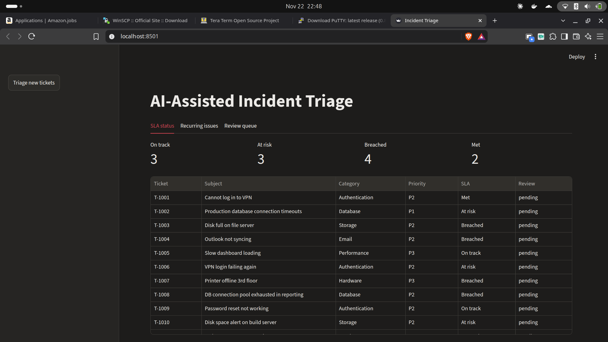

# AI-Assisted Incident Triage Tool

A Python tool that triages IT support tickets with an LLM. It reads tickets and logs, redacts sensitive data, classifies category and priority, suggests likely root causes and knowledge-base (KB) articles, keeps a human in the loop for validation, and tracks SLA status and recurring issues on a dashboard.

Runs fully offline with a rule-based fallback, so it works as a demo without an API key.



## Features

- **LLM triage**: classifies each ticket (category, priority P1 to P4), suggests up to two likely root causes and relevant KB articles, returned as structured JSON.
- **Redaction before the model**: emails, IP addresses, phone numbers, SSNs and `password=...` / token / API-key patterns are masked before any text is sent out.
- **Grounded KB suggestions**: candidate articles are retrieved by keyword first, and the model may only choose from that list. Any ID it returns that isn't in the KB is dropped.
- **Human validation**: every AI suggestion starts as `pending`. A person accepts, edits or rejects it, in the terminal or in the dashboard.
- **SLA tracking**: status is computed from the final (human-reviewed) priority when one exists.
- **Recurring-issue trends**: groups tickets by category and root cause to surface repeat problems.
- **Offline fallback**: with no API key (or if the API call fails), a keyword/regex heuristic produces the same output shape.

## Pipeline

```
ticket + log tail
      |
      v
  redact (email, IP, phone, secrets)
      |
      v
  KB retrieval (keyword overlap)
      |
      v
  LLM -> JSON {category, priority, root_causes, kb_ids}
      |        (heuristic fallback if no key / error)
      v
  human review: accept / edit / reject
      |
      v
  SLA status + recurring-issue dashboard
```

## Setup

Requires Python 3.10+. On Debian/Ubuntu, use a virtual environment (system-wide `pip install` is blocked):

```bash
python3 -m venv .venv
source .venv/bin/activate
pip install -r requirements.txt
```

If venv creation fails: `sudo apt install python3-venv`.

## Usage

```bash
python -m triage.cli run        # triage all tickets (skips ones already done)
python -m triage.cli review     # human validation in the terminal
python -m triage.cli summary    # print priority + SLA status per ticket
streamlit run dashboard.py      # dashboard at http://localhost:8501
```

To use Claude instead of the fallback:

```bash
export ANTHROPIC_API_KEY=your-key
export TRIAGE_MODEL=claude-sonnet-5-5   # optional; this is the default
rm data/results.json                    # re-triage tickets already processed
python -m triage.cli run
```

The output shows `[llm]` or `[heuristic]` per ticket so you can see which path was used.

## Dashboard

| Tab | What it shows |
|---|---|
| **SLA status** | Counts for On track / At risk / Breached / Met, plus a ticket table with category, priority, SLA and review state |
| **Recurring issues** | Root causes seen on 2+ tickets, and ticket volume by category |
| **Review queue** | Pending AI suggestions with causes, KB links and what was redacted; approve, edit or reject |

The sidebar button triages any tickets that haven't been processed yet.

## SLA rules

| Priority | Target |
|---|---|
| P1 | 4 hours |
| P2 | 8 hours |
| P3 | 24 hours |
| P4 | 72 hours |

Open tickets are **On track** until 75% of the target has elapsed, then **At risk**, then **Breached**. Resolved tickets are **Met** or **Breached** based on time to resolve. Targets live in `triage/sla.py`.

## Project structure

```
incident-triage/
  dashboard.py          Streamlit dashboard + review queue
  requirements.txt
  data/
    tickets.json        sample tickets (ages are relative to "now")
    logs/               one log file per ticket
    kb.json             knowledge-base articles
    results.json        generated: AI output + review decisions
  triage/
    cli.py              run / review / summary commands
    engine.py           loading, redaction -> retrieval -> LLM pipeline
    redact.py           regex-based redaction
    llm.py              Claude call + offline heuristic fallback
    sla.py              SLA targets and status logic
```

## Design notes and limitations

- **Redaction is regex-based.** It covers common patterns but not everything (for example, personal names in free text). Treat it as a safeguard, not a guarantee, and extend `triage/redact.py` for your data.
- **Human review is required by design.** AI output is a suggestion; the reviewed category and priority take precedence in the dashboard.
- **Sample data is synthetic.** Ticket timestamps are generated relative to the current time so SLA statuses stay meaningful.
- **Results are cached** in `data/results.json`. Delete it to start fresh.
- **Heuristic fallback is intentionally simple.** It exists so the project runs anywhere; the LLM path is the intended one.

## Ideas for next steps

- Accuracy view: AI suggestion vs. final human decision, per category.
- Embedding-based KB retrieval instead of keyword overlap.
- Load tickets from a real export or ticketing-system API.
- Unit tests for redaction and SLA logic.
